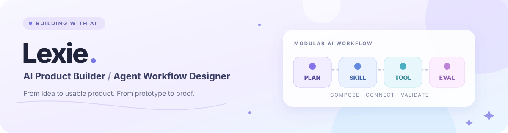

  

### Hi, 我是 Lexie👋

**AI Product Builder · AI 产品经理 / AI 应用与 Agent 工作流设计**

把需求变成产品，把 AI 能力接入真实流程。  
**13 个作品实践 · 11 个已完成阶段性版本 · 持续构建中**

[🌐 个人作品集](https://haluwjm-lexie.github.io/Lexie_Introduction/) · [🧠 AIPMATE 在线体验](https://aipmate-v1.vercel.app/) · [🛍️ CrystalOps 客服演示](https://haluwjm-lexie.github.io/Crystalops/)

---

## 👩🏻‍💻 关于我 / About Me

我有**精算学背景**，现在专注 AI 产品、Agent 工作流与 AI 应用实践。我喜欢把一个模糊的业务需求，拆解成清晰的产品方案，再用 AI 编程工具、模型 API、Skill 和自动化工作流，把它做成**可以使用、观察、测试和持续迭代的产品**。

我的关注点不只是“AI 能不能回答”，而是：**AI 应该负责哪一步？需要什么数据和工具？出现问题怎么办？怎样验证结果真的可用？**

`需求分析` → `AI 方案设计` → `Workflow / Agent / Skill` → `产品原型与开发` → `测试、评估与迭代`

> **我的角色：** 负责场景选择、产品定义、信息架构、业务规则、交互体验和验收迭代；借助 AI 编程工具完成原型开发、调试与交付。公开作品主要用于产品能力验证与交流，不将演示数据等同于真实客户成果。

## 🧩 我的核心能力：模块化“插槽”思维

我希望做的不是只能解决一种问题的 AI Demo，而是**可以按业务替换知识、模型、技能、工具和评测标准的可复用解决方案**。

| 可替换模块 | 我关注的问题 | 对应实践 |
| --- | --- | --- |
| **Model / 模型** | 选哪个模型？效果、延迟与 Token 成本如何平衡？ | [Modelwise](https://github.com/Haluwjm-Lexie/Modelwise)、[AIPMATE](https://github.com/Haluwjm-Lexie/aipmate-v1) |
| **Knowledge / 知识** | 如何处理资料、检索证据，减少无依据回答？ | [RAG Lab](https://github.com/Haluwjm-Lexie/rag-lab)、[Knowledge Distiller](https://github.com/Haluwjm-Lexie/Knowledge_Distiller) |
| **Skill / 能力** | 如何将可重复任务变成清晰、可维护的能力单元？ | [Skill Lab](https://github.com/Haluwjm-Lexie/Skill-Lab)、[Lexie Skill](https://github.com/Haluwjm-Lexie/lexie-skill) |
| **Tool / 工具** | 如何让 AI 与业务数据、计算、外部 API 协作？ | [CrystalOps](https://github.com/Haluwjm-Lexie/Crystalops)、[AIPMATE](https://github.com/Haluwjm-Lexie/aipmate-v1) |
| **Harness / Eval** | 如何管理运行步骤、失败处理、权限和结果检查？ | [Harness Lab](https://github.com/Haluwjm-Lexie/Harness_lab)、[CrystalOps](https://github.com/Haluwjm-Lexie/Crystalops) |

**当前边界：** 这是我在多个作品中持续探索的产品架构方法；并不意味着所有作品已集成为一套系统，或已经完成跨行业、生产环境的一键迁移。

## 🚀 精选案例 / Featured Work

### 01 · [AIPMATE — AI 产品经理助理](https://github.com/Haluwjm-Lexie/aipmate-v1)

**从一句模糊需求，推进到可讨论的产品交付物。** 集成需求分析、AI 方案设计、PRD 草稿与竞品分析；支持多轮讨论、历史版本和浏览器本地工作区。通过服务端安全调用 DeepSeek API，强调业务事实边界、MVP 判断与可执行验收标准。

**证明的能力：** AI PM 工作流设计 · Prompt / 业务规则体系 · API 集成 · 结构化文档与产品交付

[▶ 在线体验](https://aipmate-v1.vercel.app/) · [查看仓库](https://github.com/Haluwjm-Lexie/aipmate-v1)

### 02 · [CrystalOps — AI 客服与运营工作台](https://github.com/Haluwjm-Lexie/Crystalops)

**从“客服回复”延伸到“有计划、有工具、有证据、有评测”的业务工作流。** 以水晶电商为案例，将 Plan / Skill / Tool / Eval 拆为可理解、可检查的模块，提供商品咨询、优惠计算、执行记录、Skill 实验与规则评测。

**证明的能力：** 业务需求拆解 · Agent 架构思维 · 工具编排 · 过程可观测性 · 评测设计

[▶ 在线体验](https://haluwjm-lexie.github.io/Crystalops/) · [查看仓库](https://github.com/Haluwjm-Lexie/Crystalops)

公开体验版使用模拟业务资料与浏览器规则模型，不接入真实交易或远程大模型；“跨业务插槽复用”是设计思路，仍需新的业务场景验证。

### 03 · [RAG Lab — 检索增强生成实验室](https://github.com/Haluwjm-Lexie/rag-lab)

**让 RAG 从概念变成能观察和对比的步骤。** 覆盖资料导入、切块、检索、重排、证据检查与 A/B 评估，并区分教学算法与真实模型调用，帮助理解“为什么检索结果会影响回答质量”。

**证明的能力：** RAG 链路设计 · 检索与评估 · 实验变量控制 · AI 产品教学化表达

[▶ 在线体验](https://rag-lab-tau.vercel.app/) · [查看仓库](https://github.com/Haluwjm-Lexie/rag-lab)

线上版本适合演示与学习；使用中的数据持久性和模型接入能力请以项目说明为准。

### 04 · [AI Daily — AI 资讯与开源趋势自动化平台](https://github.com/Haluwjm-Lexie/AI-Daily)

**让分散的 AI 信息成为可持续阅读的个人情报系统。** 整理 AI 资讯、历史日报和 GitHub Trending，通过 GitHub Actions 实现定时处理、构建和公开发布，并加入个人收藏与飞书通知工作流。

**证明的能力：** 自动化工作流 · 数据采集与去重 · 信息架构 · GitHub Actions · 持续发布

[▶ 在线体验](https://haluwjm-lexie.github.io/AI-Daily/) · [查看仓库](https://github.com/Haluwjm-Lexie/AI-Daily)

## 🗂️ 全部作品 / Project Library

下面按**业务价值与能力方向**分类，而不是按开发顺序罗列。

### AI 业务应用与个人助手

| 作品 | 解决的问题 | 体验 / 源码 |
| --- | --- | --- |
| **AIPMATE** · AI 产品经理助理 | 将需求推进为需求分析、AI 方案、PRD 和竞品分析 | [体验](https://aipmate-v1.vercel.app/) · [代码](https://github.com/Haluwjm-Lexie/aipmate-v1) |
| **CrystalOps** · AI 客服工作台 | 将客服场景拆成规划、能力、工具和评测模块 | [体验](https://haluwjm-lexie.github.io/Crystalops/) · [演示仓库](https://github.com/Haluwjm-Lexie/Crystalops) |
| **Personal OS** · 个人超级工作台 | 整合个人目标、专业任务与 AI 助手的工作空间 | **本地版本｜持续迭代，暂无公开仓库** |
| **Daily Coach** · AI 每日复盘 | 目标管理、专注计时、日思录与 DeepSeek AI 日报 | [体验](https://haluwjm-lexie.github.io/daily-coach/) · [代码](https://github.com/Haluwjm-Lexie/daily-coach) |

### Agent、Skill、RAG 与运行机制

| 作品 | 解决的问题 | 体验 / 源码 |
| --- | --- | --- |
| **RAG Lab** · RAG 实验室 | 可视化学习建库、检索、上下文与效果评估 | [体验](https://rag-lab-tau.vercel.app/) · [代码](https://github.com/Haluwjm-Lexie/rag-lab) |
| **Skill Lab** · Skill 实验室 | 导入、检查、编辑和回放 Skill 结构与规则 | [体验](https://haluwjm-lexie.github.io/Skill-Lab/) · [代码](https://github.com/Haluwjm-Lexie/Skill-Lab) |
| **Harness Lab** · Agent 运行策略实验室 | 理解上下文、权限、工具失败与任务恢复等机制 | [体验](https://haluwjm-lexie.github.io/Harness_lab/) · [代码](https://github.com/Haluwjm-Lexie/Harness_lab) |
| **Knowledge Distiller** · AI 知识蒸馏 Skill | 将零散信息分阶段整理为可复用的知识资产 | [Skill 仓库](https://github.com/Haluwjm-Lexie/Knowledge_Distiller) |
| **Lexie Skill** · 正文手绘配图 | 将中文内容转化为风格一致的插图策略与配图 | [Skill 仓库](https://github.com/Haluwjm-Lexie/lexie-skill) |

### AI 效率工具、产品设计与个人 IP

| 作品 | 解决的问题 | 体验 / 源码 |
| --- | --- | --- |
| **AI Daily** · AI 情报自动化 | 聚合 AI 资讯、GitHub Trending 和历史信息 | [体验](https://haluwjm-lexie.github.io/AI-Daily/) · [代码](https://github.com/Haluwjm-Lexie/AI-Daily) |
| **Modelwise** · AI 模型选型 | 对比模型能力、场景和 Token 成本，辅助选型 | [体验](https://haluwjm-lexie.github.io/Modelwise/) · [代码](https://github.com/Haluwjm-Lexie/Modelwise) |
| **Love Rating** · 恋爱选择互动测试 | 通过 12 道情境题探索选择倾向，生成趣味结果卡 | [体验](https://haluwjm-lexie.github.io/love-rating/) · [代码](https://github.com/Haluwjm-Lexie/love-rating) |
| **Lexie Introduction** · 个人 AI 作品集 | 用交互式网站展示项目、经历与设计过程 | [访问网站](https://haluwjm-lexie.github.io/Lexie_Introduction/) · [代码](https://github.com/Haluwjm-Lexie/Lexie_Introduction) |

上述 13 项包含 12 个公开项目仓库和 1 个本地项目。已完成数量按个人当前阶段统计；“可在线体验”不等于已完成企业级部署。部分公开版本采用模拟数据或浏览器内规则运行，请以各仓库 README 的能力说明为准。

## 🤝 可以聊聊什么 / Let's Build

如果你是 **AI 产品经理招聘方**，可以从 [AIPMATE](https://github.com/Haluwjm-Lexie/aipmate-v1)、[CrystalOps](https://github.com/Haluwjm-Lexie/Crystalops) 和 [RAG Lab](https://github.com/Haluwjm-Lexie/rag-lab) 看我如何拆需求、设计 AI 边界、组织业务流程与验证产品。

如果你是 **个人创业者或小团队负责人**，我尤其乐意交流这些场景：

- **AI 客服 / 知识库助手**：业务流程梳理、FAQ / RAG 原型、Tool / Skill 设计与评测方案。
- **个人 AI 助理 / 工作流**：信息整理、重复任务自动化、模型/API 与外部工具的组合。
- **AI 小工具 / MVP**：从业务问题、功能优先级、交互原型到可体验的初版产品。
- **AI 内容与效率系统**：情报聚合、内容生产流程、自动化日报与成本选型。

我重视**需求和数据边界、可验证结果、合理成本**。真实业务项目需要进一步确认数据权限、系统接口、预算与部署要求，不会把演示原型直接包装为成熟生产系统。

## 🔧 工具与技术 / Toolbox

`ChatGPT` `DeepSeek` `Codex` `Claude` `Cursor` `Prompt Engineering` `Agent / Skill / MCP` `RAG` `API Integration` `Next.js` `React` `TypeScript` `Node.js` `GitHub Actions` `Vercel` `GitHub Pages` `Vibe Coding`

---

**Build · Learn · Ship · Improve**

欢迎交流 **AI PM / AI 应用 / Agent 工作流 / 产品合作**。  
通过 [个人网站](https://haluwjm-lexie.github.io/Lexie_Introduction/) 找到我，或查看 [全部 GitHub 仓库](https://github.com/Haluwjm-Lexie?tab=repositories)。

*Made with curiosity & care — Lexie ✦*

